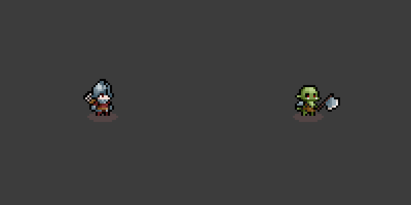
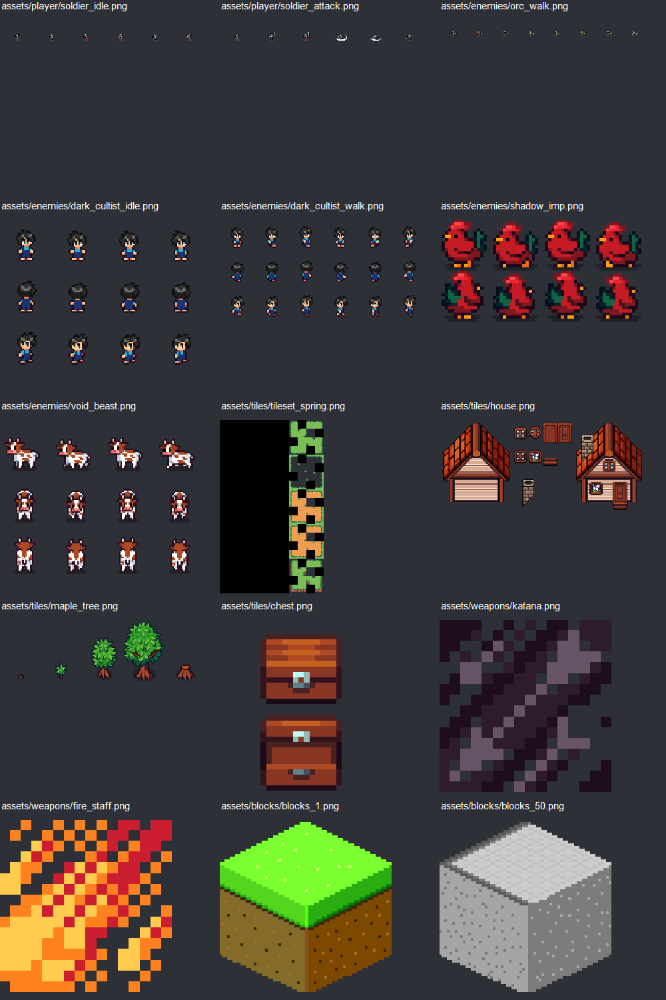

# TÀN TRO MÙA GẶT — Thiết kế game v0.1

Ngày: 16/09/2026. Tài liệu ý tưởng và kế hoạch, chưa phải game đã triển khai. Mọi chỉ số cân bằng là giá trị thử nghiệm ban đầu.

## 1. Quyết định sản phẩm

**Một hiệp sĩ đi qua ngôi làng bị nguyền rủa, vượt các đấu trường ngắn, nhặt kinh nghiệm và kết hợp di vật để mạnh lên trước khi lời nguyền lan rộng.**

- Thể loại: action roguelite 2D, góc nhìn từ trên xuống hơi nghiêng; di chuyển 8 hướng, hình nhân vật quay trái/phải tùy animation có sẵn.
- Mục tiêu ban đầu: chơi đơn trên PC, bàn phím và chuột; tay cầm ở giai đoạn hoàn thiện.
- Một lượt hoàn chỉnh: 12 màn, khoảng 20–30 phút; thua quay về làng, level và đồ trong lượt mất, mở khóa dài hạn giữ lại.
- Điểm hấp dẫn: mỗi 30–60 giây có tiến bộ rõ ràng; cứ vài phút chọn đánh nhanh để an toàn hay gọi thêm đợt quái để lấy phần thưởng.
- Tông hình: pixel art fantasy nông thôn, màu cỏ sáng bị xâm lấn bởi tím/đỏ của lời nguyền. Không cần biến toàn bộ asset thành dungeon tối.
- Ba trụ cột: chiến đấu dễ đọc; build thay đổi cách chơi; bản đồ và phần thưởng thay đổi mỗi lượt.
- Chủ động giới hạn bản đầu: một nhân vật, không multiplayer, không thế giới mở, không hệ thống trồng trọt hay chế đồ phức tạp.

Có nâng cấp/mở khóa giữ lại giữa các lượt nên tên thể loại chính xác hơn là roguelite. Cảm giác người chơi vẫn là roguelike vượt màn, mất build khi chết.

## 2. Asset thực tế và hệ quả thiết kế

Đã kiểm tra danh sách file, kích thước PNG, hình mẫu và một số bản sao bằng SHA-256. Có 6.892 PNG, 6.722 hash PNG khác nhau; con số này **không phải** số đối tượng gameplay vì gồm nhiều kích thước, sheet và bản xuất của cùng nội dung. Chưa xem từng icon hoặc nghe từng bản nhạc.

| Nhóm | Tài nguyên đã xác nhận | Dùng vào game | Giới hạn cần tôn trọng |
|---|---|---|---|
| Nhân vật | `assets/player/soldier_*`: idle 600×100, walk 800×100, attack 600×100, hurt/death 400×100 | Hiệp sĩ mặc định; frame 100×100, lần lượt 6/8/6/4/4 ô | Nhân vật thực nhỏ bên trong frame; không scale toàn bộ khung thành kích thước hitbox |
| Orc | Idle, walk, hurt, death, attack01, attack02 trong `assets/enemies` và pack Tiny RPG | Bộ binh, chiến binh, thủ lĩnh Orc | Biến thể cùng sprite phải phân biệt bằng màu, biểu tượng và nhịp đòn |
| `dark_cultist_*` | Idle 128×96, walk 192×96; bản sao đúng hash của nhân vật Farm RPG | Dân làng bị ám; người bán hàng ở hub | Hình không phải pháp sư hắc ám; chưa có animation đánh riêng |
| `shadow_imp.png` | 64×32; bản sao của `Chicken Red.png` | Gà bị nguyền: quái lao nhanh | Không gọi là quỷ bay; bố trí frame cần xem kỹ trước import |
| `void_beast.png` | 128×96; bản sao của `Male Cow Brown.png` | Bò cuồng nộ: quái lao húc và boss | Không có sẵn animation quái hư không |
| Nền và vật thể | `tileset_spring`, nhà, cây phong, rương, cây trồng; pack gốc thêm hàng rào, đường, nội thất, gia súc | Cánh đồng, sân trại, vườn cây, làng; hub tái sử dụng nhà | Chưa có bộ dungeon, tuyết, dung nham riêng |
| Trang bị | 38 PNG trong `assets/weapons`: 37 ảnh 64×64 và `arrow.png` 32×32 | Icon chọn đồ, nâng cấp, HUD; thử dùng mũi tên làm projectile | Bao gồm cả rune/bình sách; không có 38 bộ animation vũ khí |
| Raven Fantasy Icons | 6.580 file trong cả pack, nhiều cách đóng gói/kích thước | Chọn một bộ kích thước thống nhất cho kỹ năng, đồ và tiền | Không tính toàn bộ file thành item độc lập; `katana.png` trùng `64x64/fc1408.png` |
| Block isometric | Hai thư mục block, 101 PNG mỗi bộ | Dự trữ cho dự án/biến thể góc nhìn khác | Không trộn trực tiếp nền hình thoi với nền Farm RPG trong bản đầu |
| Âm nhạc | 4 OGG trong `music`, 29 OGG trong `music loop` | Menu, giao tranh, cửa hàng, boss | Chưa nghe thử để chốt sắc thái; combat trùng bài SHROUDED FUTURE bằng hash |

`assets/HUONG_DAN_ASSET.md` mô tả một cơ chế tự nhận asset và các file ví dụ như knight/minion/boss. Thư mục làm việc hiện chỉ có assets trước khi lập tài liệu này; không thấy mã game chứng minh cơ chế đó đang tồn tại. Không lấy các tên ví dụ làm tài nguyên đã có.

### Quy tắc hình ảnh

- Lấy Farm RPG 16×16 làm chuẩn nền. Đặt chân nhân vật làm điểm neo, sắp lớp theo tọa độ chân; collision chỉ bao quanh chân/thân thích hợp.
- Soldier/Orc có thể di chuyển tự do nhưng chỉ lật ngang cho hướng đối diện; không hứa có sprite 4/8 hướng đầy đủ. Test nhanh việc trộn với Farm RPG trước khi làm nhiều màn.
- Dùng lọc nearest-neighbor và tỉ lệ phóng nguyên; độ phân giải nội bộ thử nghiệm 640×360. Các ô 100×100 chứa nhiều khoảng trống phải có metadata frame/pivot riêng.
- Sheet Farm RPG nhân vật và bò có thể chia lưới 32×32 theo kích thước đã đo; thứ tự hướng và frame phải xác nhận khi import. Rương 32×32 là sheet nhiều trạng thái, không coi cả ảnh là một rương.
- Vũ khí đang có chủ yếu là icon: hiệp sĩ giữ hoạt ảnh kiếm mặc định; staff/bow/rune được thể hiện bằng phép, projectile hoặc di vật bay quanh. Muốn đổi vũ khí thực sự trên tay cần vẽ/chỉnh sprite bổ sung.
- Lời nguyền được biểu đạt bằng tint nhẹ, dấu chân, vòng phép và hạt bụi làm bằng mã; giữ bóng dáng gà, bò và Orc nhận ra được.
- Đòn nguy hiểm có hình báo trước, âm báo và chuyển động; không chỉ dùng màu đỏ để truyền đạt.

### Nội dung còn thiếu

Chưa thấy bộ SFX riêng, font UI đã xác minh tiếng Việt, bộ UI hoàn chỉnh, animation boss riêng hay hiệu ứng phép chuyên biệt. Bản prototype dùng UI hình học, hiệu ứng đơn giản bằng mã, sprite có sẵn và âm thanh thử nghiệm. Bản phát hành cần chọn/bổ sung SFX, kiểm tra font, duyệt animation và ghi nguồn asset.

Trong file cục bộ, Music Loop ghi CC0 và Isometric có License.txt. Chưa thấy file license đi kèm Farm RPG, Tiny RPG và Raven ở lần rà soát này; đưa việc lưu nguồn và điều khoản từng pack vào checklist phát hành. Không suy ra quyền dùng từ chữ “Free”.

## 3. Thế giới và vòng lặp

Sau một mùa gặt, các hạt giống cổ đánh thức lời nguyền dưới rễ cây phong. Orc chiếm các lối ra, gia súc trở nên hung dữ, dân làng mắc kẹt trong nghi lễ. Người chơi là vệ binh cuối cùng, phải phá ba ấn phong trước khi làng bị nuốt chửng.

Tên làm việc: **Tàn Tro Mùa Gặt / Ashen Harvest**; chưa kiểm tra trùng tên thương mại.

Vòng lặp 10 giây: đọc cảnh báo → di chuyển/né → chém hoặc phép tự kích hoạt → gom XP → chọn vị trí tiếp theo.

Vòng lặp mỗi màn: vào đấu trường → hoàn thành mục tiêu → nhận đồ/chọn thưởng → quyết định thách thức thêm → qua cổng.

Vòng lặp mỗi lượt: chọn di vật đầu → 3 chương, mỗi chương 4 màn → đánh boss cuối → trở về với phần thưởng; khi chết thì kết thúc lượt sớm.

Vòng lặp dài hạn: mở thêm di vật, nâng vài tiện ích ở làng, tìm build mới, thắng để mở mức Lời Nguyền cao hơn.

## 4. Điều khiển và cảm giác chiến đấu

| Thao tác | Mặc định | Chi tiết |
|---|---|---|
| Di chuyển | WASD | Chuẩn hóa đường chéo; không trượt |
| Ngắm | Chuột | Hướng đánh ưu tiên con trỏ |
| Đánh | Giữ chuột trái | Tự lặp theo tốc độ đánh; có tùy chọn tự đánh |
| Lướt | Space | 1 lượt tích, hồi 2 giây, miễn sát thương 0,18 giây trong pha đầu |
| Kỹ năng chủ động | Q | Một kỹ năng theo di vật khởi đầu; hồi 8–15 giây |
| Tương tác | E | Rương/cổng/NPC, luôn có gợi ý rõ |
| Tạm dừng | Esc | Dừng toàn bộ thời gian chiến đấu |

Hiệp sĩ khởi đầu: 100 HP, kiếm gây 12 sát thương mỗi 0,55 giây, chí mạng 5% với hệ số 1,5. Khi trúng đòn có 0,45 giây bảo vệ để tránh mất toàn bộ máu do nhiều collider chạm cùng lúc. Đây là giả thuyết cân bằng, cần test.

Đòn kiếm: chuẩn bị ngắn → một thời điểm gây sát thương → hồi đòn. Mỗi mục tiêu chỉ trúng một lần trong một nhát. Hiệu ứng đánh trúng gồm nháy sáng, số sát thương tùy tắt, đẩy lùi nhẹ và rung màn hình có thanh chỉnh.

Ưu tiên quyền điều khiển: lướt được ngắt đoạn hồi đòn, không ngắt đòn để nhân đôi sát thương. Không khóa nhân vật đứng yên lâu khi dùng phép.

## 5. Cấu trúc 12 màn

Mỗi chương gồm ba màn thường và một boss. Ba loại địa điểm dùng **chính nền mùa xuân** với bố cục, đạo cụ và ánh sáng khác nhau; đây không phải ba tileset mới.

| Chương | Bối cảnh | Màn 1/2/3 trong chương | Boss màn 4 |
|---|---|---|---|
| I — Đồng cỏ thất thủ | Cỏ, đường đất, hàng rào, cây trồng | Dọn 3 đợt; sống sót 75 giây; phá 2 ấn | Thủ lĩnh Orc |
| II — Sân trại cuồng nộ | Nhà, chuồng gợi bằng hàng rào, ngõ rộng | Dọn đợt hỗn hợp; giữ khu vực tổng 30 giây; săn tinh anh | Bò Sừng Tro |
| III — Vườn phong tàn úa | Cây phong, gốc cây, nền cũ đổi ánh sáng | Phá 3 ấn; sống sót 90 giây; dọn hộ vệ | Kẻ Gặt Hồn, biến thể Orc |

- Màn thường mục tiêu 60–100 giây; boss 90–150 giây. Cộng chọn đồ/chuyển màn cho tổng lượt khoảng 20–30 phút.
- Màn dọn quái sinh số đợt hữu hạn; hết đợt là thắng. Màn sinh tồn có thời gian kết thúc rõ; không ép tiêu diệt vô hạn.
- Màn phá ấn: ấn là hình phép bằng mã, không giả định có sprite altar. Dừng sinh quái khi phá hết; phần còn lại phải dọn trong giới hạn hữu hạn.
- Tương tác cửa hàng giữa chương bằng giao diện và NPC Farm RPG; đồng hồ dừng.
- Sau boss cuối, hoàn tất lượt. Endless là mở rộng sau bản 1.0, không buộc người mới đánh vô hạn.

### Sinh màn ngẫu nhiên có kiểm soát

Bản đầu chọn từ 6 mẫu đấu trường đã làm tay; bản đầy đủ 12 mẫu. Seed quyết định mẫu, vị trí vật cản hợp lệ, đội hình quái và phần thưởng. Không dùng sinh map hoàn toàn tự do trong MVP.

Mỗi mẫu có điểm vào, cổng ra, vùng spawn, ô cấm spawn và đường đi tối thiểu. Kiểm tra mọi mục tiêu/cổng tới được từ điểm vào; chừa vùng né quanh boss, tránh cây che người chơi. Spawn ngoài vùng an toàn quanh người chơi và báo trước 0,7 giây. Lỗi mẫu thì dùng đấu trường trống đã kiểm tra.

Mỗi màn cho chọn một trong hai phần thưởng nhìn thấy trước: tấn công / sinh tồn, hoặc vàng / di vật. Lựa chọn đổi build, chưa làm bản đồ phân nhánh phức tạp.

## 6. Tăng sức mạnh và áp lực theo thời gian

### Level trong lượt

XP đến từ hạ quái và hoàn thành mục tiêu, không cộng level chỉ vì đứng chờ. Người chơi mạnh dần trong thời gian chơi nhờ chiến đấu; game đồng thời tăng áp lực theo thời gian hoạt động.

- Level khởi đầu 1; mục tiêu kết thúc lượt ở level 20–25, giới hạn thử nghiệm 30.
- XP lên level kế tiếp: `12 + 4 × (level − 1)`; quái thường 2 XP, quái nặng 4, tinh anh 12, boss 30.
- Mục tiêu màn cộng 8 XP; mỗi chương khoảng 300–430 XP gồm quái và mục tiêu. Tổng 900–1.290 XP gần vùng level 19–24, cần đo và chỉnh mật độ/XP để đạt mục tiêu.
- Đủ XP: dừng game, chọn 1 trong 3 nâng cấp khác nhau, áp dụng rồi tiếp tục. Không mất XP thừa; nếu lên nhiều level thì xử lý lần lượt.
- Mỗi level tự cộng +2 HP tối đa và hồi 2 HP; phần thay đổi lớn đến từ lựa chọn. Không cộng sát thương tự động ở mọi level để tránh tăng kép khó cân bằng.
- Sau level trần, mỗi thanh XP đầy cho phần thưởng nhỏ như hồi máu/vàng, không hiện lựa chọn vô dụng.

### Đồng hồ Lời Nguyền

`t` là số phút đang giao tranh trong toàn lượt. Dừng t khi pause, chọn nâng cấp, cửa hàng, chuyển cảnh và sau khi hoàn thành mục tiêu; không đặt lại khi qua màn.

- HP quái cơ bản nhân `1 + 0,08 × (s−1) + 0,012 × t`, với s là màn 1–12.
- Sát thương quái nhân `1 + 0,045 × (s−1) + 0,006 × t`.
- Ngân sách sinh quái nhân `min(1,7; 1 + 0,04 × t)`; chỉ áp dụng trong thời gian/mục tiêu sinh quái cho phép.
- Mỗi chương mở một hành vi khó hơn: thêm quái nhanh, thêm bắn xa, cuối cùng đội hình hỗn hợp. Không tăng tốc chạy toàn bộ quái vô hạn.
- Boss dùng cùng hệ số màn/thời gian một lần; không nhân thêm một lớp độ khó chương trùng lặp.

Ví dụ màn 9 ở phút 15: HP quái ×1,82, sát thương ×1,45, ngân sách spawn ×1,60. Quái thường vẫn cần chết nhanh trước build tốt; nếu quái hóa thành “bao cát”, giảm HP trước khi tăng sát thương người chơi.

### Quyết định đặc trưng: Gặt thêm hay rời đi

Sau một màn thường, người chơi được rời ngay hoặc kích hoạt **Gặt Tham**: thêm một đợt 20 giây, nhận rương nâng cao nếu thắng. Chỉ một lần/màn, không dùng ở boss; t chạy lại trong thử thách. Hiển thị rõ loại thưởng và quái tinh anh trước khi chọn. MVP chưa cần cơ chế này; thêm khi vòng lặp cơ bản đã vui.

## 7. Build, vũ khí và tiến hóa

Mỗi lượt có 1 đòn kiếm nền, tối đa 2 di vật tấn công tự kích hoạt và 3 bùa thụ động. Đòn kiếm có thể đổi tính chất bằng nâng cấp nhưng chưa đổi sprite cầm tay. Mỗi món có 5 cấp; chỉ chọn 6 di vật tấn công cho bản đầy đủ.

| Nhánh | Icon có thật | Cơ chế cần lập trình | Tiến hóa |
|---|---|---|---|
| Hỏa | `fire_staff`, `inferno_staff` | Bắn cầu lửa, cháy 3 giây; tối đa 3 cộng dồn | Hỏa Trượng + Mana Flask → Inferno: nổ nhỏ khi mục tiêu cháy chết |
| Băng | `frost_staff`, `blizzard_staff` | Đạn làm chậm 20%, tối đa 40%; boss giảm hiệu quả | Băng Trượng + Arcane Tome → Blizzard: vùng bão ngắn |
| Lôi | `thunder_scepter`, `power_surge_gem` | Sét nối tối đa 3 mục tiêu, có giới hạn khoảng cách | Lôi Trượng + Power Surge Gem → sét thêm một nhánh |
| Huyết | `blood_spear`, `blood_catalyst` | Đâm xuyên theo hướng ngắm; hồi máu có giới hạn theo giây | Huyết Thương + Blood Catalyst → vệt máu gây sát thương |
| Cung hồn | `composite_bow`, `soul_bow`, `arrow` | Mũi tên tự chọn mục tiêu gần hướng ngắm | Cung + Berserk Rune → Soul Bow: thêm xuyên mục tiêu |
| Hư vô | `void_wand`, `arcane_tome` | Vùng hút nhẹ quái thường, không hút boss | Void Wand + Arcane Tome → vùng nổ khi kết thúc |

Điều kiện tiến hóa: di vật cấp 5 + bùa tương ứng tối thiểu cấp 3 + đã thắng ít nhất một boss. Rương boss cho chọn tiến hóa nếu đủ điều kiện; thay món cũ trong cùng slot, không cộng bản sao. UI hiển thị công thức ngay từ lúc nhận món.

Bùa dùng ở MVP: Mana Flask giảm hồi chiêu, Power Surge Gem tăng sát thương phép, Berserk Rune tăng tốc đánh nhưng giảm HP tối đa. Các bùa còn lại bổ sung cùng nhánh liên quan.

Quy tắc roll nâng cấp: không trùng trong cùng lượt chọn; loại món max cấp; slot đầy thì chỉ roll nâng món đang cầm hoặc chỉ số chung. Mỗi lượt có 1 lần đổi lựa chọn miễn phí; không để người chơi kẹt vì pool hết. Rương boss đảm bảo ít nhất một nâng cấp dùng được.

Ví dụ build: kiếm nhanh + sét + cung cho dọn đám; kiếm lửa + hỏa trượng + hút hư vô cho gom quái; băng + huyết thương + HP cho an toàn. Hiệu ứng kích hoạt lẫn nhau có giới hạn tần suất để tránh vòng lặp nổ vô hạn.

Các icon súng, laser, cannon vẫn có trong thư mục nhưng để dành cho bản mở rộng; bản đầu giữ chủ đề fantasy và khối lượng cân bằng vừa sức.

## 8. Quái, tinh anh và boss

| Loại | Hình dùng | Hành vi | HP / sát thương nền đề xuất | Cách đối phó |
|---|---|---|---|---|
| Orc bộ binh | Orc gốc | Tiến gần, giơ rìu 0,45 giây, chém | 30 / 10 | Đi vòng hoặc lướt qua |
| Orc chiến binh | Orc có dấu tinh anh, attack02 | Hai nhát, khoảng nghỉ dài sau chuỗi | 65 / 12 mỗi nhát | Đợi hết chuỗi để đánh |
| Gà nhiễm nguyền | Chicken Red / shadow_imp | Đứng lấy đà 0,5 giây rồi lao thẳng | 14 / 6 | Né ngang; rất ít máu |
| Bò cuồng | Male Cow / void_beast | Báo đường húc 0,9 giây, lao, choáng ngắn khi va vật cản | 100 / 18 | Dụ húc vào hàng rào |
| Dân làng bị ám | Farm Character / dark_cultist | Giữ khoảng cách, dừng 0,8 giây để phóng cầu phép bằng hiệu ứng mã | 35 / 8 | Áp sát hoặc núp vật cản |
| Hộ vệ nghi lễ | Orc biến thể có vòng phép | Bảo vệ vị trí ấn, ít đuổi theo | 80 / 14 | Tách khỏi quái bắn xa |

Chỉ ba loại đầu xuất hiện ở MVP. Bò/dân làng không có hoạt ảnh đánh được xác nhận, nên dùng điềm báo, đổi pose đang có và chuyển động bằng mã; phải duyệt độ rõ trước khi đưa vào trận đông.

Tinh anh là modifier, không phải mỗi màu là loài mới. Chỉ dùng hai modifier ban đầu: giáp (+HP, chậm hơn) hoặc cuồng nộ (chuỗi đánh thêm một nhịp). Hiển thị biểu tượng trên đầu; cấm tổ hợp gây đòn không thể né.

### Boss I: Thủ lĩnh Orc

Sprite Orc, phóng nguyên nếu phù hợp sau kiểm tra hình; không có sprite boss độc lập. HP cơ bản 900 trước hệ số màn/thời gian. Bộ chiêu: chém quạt 0,8 giây báo trước, lao thẳng, gọi tối đa 4 lính. Ở 50% HP chuyển hai nhát liên tiếp. Sau mỗi chuỗi có 1,2 giây để phản công. Gọi lính có hồi chiêu và giới hạn số lượng.

### Boss II: Bò Sừng Tro

Sprite bò, thêm dấu lời nguyền. HP cơ bản 1.300. Ba pha trong chu kỳ: cào đất báo hướng → húc → dừng cho người chơi đánh. Dưới 50% HP húc hai lần với báo hiệu riêng. Va rào tạo cửa sổ choáng 1,5 giây; nếu rào không dùng collision trong một mẫu thì có điểm chặn chuyên biệt. Không bắt người chơi đoán hướng húc.

### Boss III: Kẻ Gặt Hồn

Biến thể Orc, vòng phép và bóng mờ bằng mã. HP cơ bản 1.700. Phối hợp chém quạt, vòng đạn có khe thoát, gọi hộ vệ. Ở 60% và 30% HP chuyển pattern; mỗi lần chuyển có 1 giây cảnh báo. Tối đa 2 mối nguy chính đồng thời; boss không vừa khóa đường né vừa tấn công không báo trước. Chỉ làm boss này sau khi hai boss trước đã chứng minh combat đủ thú vị.

Boss miễn hút/đẩy lùi; hiệu quả làm chậm giảm một nửa. Các trạng thái cháy/chảy máu vẫn hoạt động để build không bị vô hiệu ở trận cuối.

## 9. Kinh tế và tiến triển giữa các lượt

Hai loại tiền để người chơi dễ hiểu:

- **Vàng trong lượt:** nhặt từ quái/rương, mua hồi máu và nâng cấp giữa chương; mất khi lượt kết thúc. Đề xuất 20–35 vàng/màn thường, +60/boss; hồi 30 HP giá 40, nâng món giá 70, đổi hàng giá 20. Chốt lại sau khi đo thu nhập thực tế.
- **Hạt Tro dài hạn:** 1/màn thường hoàn thành, 5/boss, thêm 10 khi thắng cả lượt. Được ghi nhận ở mốc hoàn thành màn và giữ cả khi chết; giết quái lẻ không cho Hạt Tro để hạn chế farm tại chỗ. Một lượt thắng đủ 12 màn cho 34 Hạt Tro.

Hub dùng nhà và nhân vật Farm RPG. Tương tác ban đầu bằng menu ba khu: Kho di vật, Đài ký ức, Cổng xuất phát. Không cần thêm ba NPC mới.

| Mở khóa | Giá thử nghiệm | Tác dụng |
|---|---:|---|
| Một di vật khởi đầu mới | 10–20 | Tăng lựa chọn build, không tự tăng mọi chỉ số |
| Túi dự phòng | 15 | Thêm 1 lần đổi lựa chọn mỗi lượt, chỉ mua 1 lần |
| Sức bền I / II | 10 / 20 | Mỗi cấp +5 HP đầu lượt; dừng ở +10 |
| Nam châm I / II | 10 / 20 | Mỗi cấp +10% bán kính nhặt; dừng ở +20% |
| Hồ sơ boss | Miễn phí khi gặp | Xem chiêu đã thấy và nguyên nhân chết |

Lượt đầu phải thắng được với kỹ năng tốt, không yêu cầu cày chỉ số. Mở khóa boss/di vật dùng thành tích khi hợp lý. Khi thắng mở Lời Nguyền I–V: thêm modifier cụ thể và thưởng, có mô tả trước khi vào; không chỉ cộng HP liên tục.

## 10. UX, âm thanh và khả năng tiếp cận

- HUD: HP góc trái; level/thanh XP trên cùng; màn + thời gian chiến đấu + mức lời nguyền góc phải; kỹ năng và cooldown dưới; vàng và di vật gọn cạnh HUD.
- Chọn nâng cấp: 3 thẻ, mỗi thẻ có icon, hiệu quả hiện tại → mới, cấp và tag build. Tạm dừng hoàn toàn; hỗ trợ chọn bằng phím 1/2/3 và chuột.
- Cuối màn: hiện mục tiêu hoàn tất, thưởng và hai nút “Đi tiếp”/“Gặt thêm”. Không ép quyết định trong thời gian đếm ngược.
- Khi chết: ghi nguyên nhân, màn đạt được, build, Hạt Tro đã giữ và nút chơi lại. Không tạo cảm giác mất tất cả tiến triển.
- Hướng dẫn lần đầu qua màn ngắn: di chuyển → chém Orc đơn → lướt khỏi báo đòn → nhận level → mở rương. Có bỏ qua.
- Tùy chọn: âm nhạc/SFX riêng, remap phím, tự đánh, tắt flash/rung/số damage; chữ có dấu đọc rõ. Dấu nguy hiểm có hình/viền riêng bên cạnh màu.
- Nhạc tạm gán theo `bgm_title`, `bgm_combat`, `bgm_shop`, `bgm_boss`; phải nghe kiểm tra trước khi duyệt, tên file không chứng minh đúng không khí.
- SFX tối thiểu cần chuẩn bị: chém, trúng đòn, lướt, nhặt XP, level up, mở rương, cảnh báo boss, chết. Giới hạn số âm chồng nhau khi đông quái.

## 11. Thiết kế hệ thống để triển khai

Chưa có engine/codebase được xác nhận; tài liệu giữ kiến trúc độc lập engine. Chốt công nghệ sau một prototype import, di chuyển và đánh trúng; không cần khóa phiên bản công cụ trong bước lên ý tưởng.

| Thành phần | Trách nhiệm |
|---|---|
| Asset catalog | Đường dẫn thật, nguồn, frame grid, pivot, FPS, animation, scale và collision |
| Player / Combat | Di chuyển, ngắm, đòn đánh, né, nhận damage, trạng thái |
| Enemy / Boss | State machine: xuất hiện, di chuyển, báo đòn, ra đòn, hồi, chết |
| Run controller | Seed, màn, t, thưởng, thắng/thua; chặn ghi thưởng trùng |
| Encounter director | Ngân sách quái, đợt, giới hạn số lượng, mục tiêu màn |
| Progression / Item | XP, roll 3 lựa chọn, slot, cấp, tiến hóa, giới hạn proc |
| Map / Navigation | Mẫu màn, vật cản, đường đi, cổng và điểm spawn |
| Save / UI / Audio | Mở khóa, cài đặt, tạm lưu lượt, menu, nhạc và hiệu ứng |

Dữ liệu quái/đồ/màn tách khỏi logic để cân bằng không phải sửa nhiều nơi. Mỗi item có ID ổn định, loại, tag, đường ảnh, cấp tối đa, giá trị từng cấp và điều kiện tiến hóa.

Lưu game: ghi meta sau hoàn thành màn và mua mở khóa; tạm lưu lượt tại cửa màn, gồm seed, màn kế tiếp, HP, XP, đồ, vàng, t và trạng thái bộ sinh ngẫu nhiên. Thoát giữa trận quay về checkpoint cửa màn; đây là tiện ích chơi đơn được chấp nhận ở MVP. Có phiên bản save và bản sao lưu; chết xóa lượt đang chạy nhưng không xóa meta.

Ngân sách hiệu năng ban đầu: mục tiêu 60 FPS trên máy thử nghiệm được ghi cấu hình, 80 quái hoạt động và 150 projectile; đây là mục tiêu cần đo, chưa phải kết quả. Dùng tái sử dụng đối tượng, gộp XP gần nhau, giới hạn hiệu ứng và không tính đường đi đầy đủ mỗi frame cho mọi quái. Khi đạt trần, trì hoãn spawn, không thả quái chồng lên người chơi.

## 12. Phạm vi phát hành

| Hạng mục | Prototype | MVP chơi trọn vòng | Bản 1.0 nhỏ |
|---|---|---|---|
| Nhân vật | Soldier | Soldier + 3 di vật mở đầu | Soldier + 6 lựa chọn mở đầu |
| Màn | 1 đấu trường | 3 màn thường + 1 boss | 12 màn, 3 chương |
| Mẫu map | 1 | 6 | 12 |
| Quái thường | Orc | Orc bộ binh, chiến binh, gà | 6 vai trò trong mục 8 |
| Boss | Chưa | Thủ lĩnh Orc | 3 boss tái sử dụng sprite |
| Di vật tấn công | 1 | 3: hỏa, lôi, cung | 6 |
| Bùa | 0–1 | 3 | 5: Mana Flask, Power Surge Gem, Berserk Rune, Arcane Tome, Blood Catalyst |
| Lựa chọn nâng cấp | 3 mẫu | 12 hiệu ứng/nâng cấp nền | Khoảng 24, không tính mỗi cấp thành món riêng |
| Tiến hóa | Chưa | 1 công thức | 6 công thức |
| Meta/save | Reset lượt | Meta nhỏ + save checkpoint | Mở khóa và Lời Nguyền I–V |
| Gặt Tham | Chưa | Sau khi core đạt nghiệm thu | Có |

## 13. Kế hoạch phát triển theo đầu ra

Ước lượng lập kế hoạch cho một lập trình viên đã quen công cụ, làm khoảng 25–35 giờ/tuần; cần thêm thời gian nếu học engine hoặc bổ sung art. Mục tiêu MVP 5–6 tuần, bản 1.0 nhỏ 10–12 tuần gồm dự phòng. Đây không phải cam kết tiến độ.

| Mốc | Thời gian | Công việc và phụ thuộc | Điều kiện hoàn thành |
|---|---|---|---|
| P0 — Khóa asset | Tuần 1, đầu tuần | Catalog, nguồn, cắt frame, pivot, scale; dựng một cảnh mẫu Farm + Soldier + Orc | Không méo hình, không nền đen sai, chân đúng vị trí; quyết định art tương thích |
| P1 — Combat | Tuần 1–2 | Di chuyển, chém, lướt, 1 Orc, damage, chết, camera; phụ thuộc P0 | Chơi lại trận 60 giây thấy phản hồi rõ; không double-hit, không kẹt collider |
| P2 — Vòng lượt | Tuần 3 | 4 màn, mục tiêu, wave, cổng, boss, game over/retry; phụ thuộc P1 | Hoàn tất một lượt 7–10 phút từ menu tới thắng/thua |
| P3 — Build | Tuần 4 | XP, 3 lựa chọn, 3 di vật, 3 bùa, 1 tiến hóa, shop | Ba hướng build cho cách xử lý trận khác nhau; không roll lựa chọn chết |
| P4 — MVP | Tuần 5–6 | Save, meta nhỏ, HUD, nhạc/SFX thử nghiệm, 6 map, test người chơi | 10 lượt thử hoàn chỉnh không blocker; hồi save đúng; đạt mục tiêu hiệu năng trên máy test |
| P5 — Mở rộng nội dung | Tuần 7–8 | Chương II–III, bò/caster, 2 boss, thêm 3 di vật, 6 tiến hóa | Một lượt 12 màn hoàn chỉnh; mỗi boss có cách đọc và né khác nhau |
| P6 — Hoàn thiện | Tuần 9–10 | Gặt Tham, Lời Nguyền I–V, âm thanh, hướng dẫn, cân bằng, tay cầm nếu kịp | Người mới hiểu vòng lặp trong 3 phút; build chính đều có thể thắng |
| Dự phòng | Tuần 11–12 | Lỗi, tối ưu, art/audio bổ sung, nguồn asset, đóng gói | Checklist phát hành sạch; build cài/chạy và save ổn trên máy sạch |

Nếu P1 chưa vui, dừng tăng nội dung và sửa combat. Nếu trễ, cắt tay cầm, Gặt Tham, Lời Nguyền cao và di vật phụ trước; giữ khả năng hoàn tất lượt, boss rõ, save và hiệu năng.

### Backlog thực thi theo thứ tự

1. Tạo catalog tối thiểu cho Soldier, Orc, tileset, rương, 3 icon, nhạc; giữ file gốc nguyên vẹn.
2. Làm cảnh thử để thống nhất tỉ lệ, pivot và góc nhìn.
3. Controller + camera + collision, rồi một đòn kiếm và một Orc có báo đòn.
4. HP/chết/retry và dash có hồi chiêu.
5. Encounter hữu hạn, mục tiêu màn, mở cổng và chuyển cảnh.
6. XP, màn chọn level, dữ liệu nâng cấp và giới hạn slot.
7. Ba di vật, một tiến hóa, rương và cửa hàng.
8. Thủ lĩnh Orc, màn kết quả và một lượt MVP hoàn chỉnh.
9. Save/meta, âm thanh, UX, đo hiệu năng và test người chơi.
10. Chỉ khi MVP đạt chuẩn mới làm chương còn lại, Gặt Tham và độ khó cao.

## 14. Kiểm thử và tiêu chí quyết định

- Import: cắt đúng frame, loop không nhảy, hurt/death kết thúc đúng, hướng lật không đảo điểm neo; animation không kéo giãn toàn bộ sheet.
- Combat: mỗi đòn trúng một lần; hết HP chết một lần; i-frame đúng; boss báo trước đủ thời gian; không combo bắt buộc chịu damage.
- Progression: XP thừa không mất; nhiều level xử lý đúng; không vượt cap; slot đầy/đồ max không làm pool rỗng; tiến hóa chỉ trừ/thay món một lần.
- Map: chạy kiểm tra 100 seed, cổng và mục tiêu luôn tới được, không spawn trong collision, mẫu lỗi có fallback.
- Save: vào lại đúng checkpoint; vàng/meta không nhân đôi; save hỏng phục hồi; thoát rồi chết không giữ build đã mất.
- Cân bằng: đo thời gian giết quái thường 1–3 giây ở sức mạnh phù hợp; boss khoảng 90–150 giây; lên cấp đầu trong 30–60 giây. Điều chỉnh theo dữ liệu, không giữ công thức bằng mọi giá.
- Playtest: 3–5 người chơi thử; ghi màn chết, nguyên nhân, lựa chọn build, thời điểm nhàm chán, thời gian hiểu điều khiển. Tách lỗi đọc đòn khỏi thiếu chỉ số.
- Hiệu năng: đo frame time ở trận đông nhất, không chỉ ở hub; ghi rõ cấu hình máy và số đối tượng. Kiểm tra chơi liên tiếp 30 phút không tăng bộ nhớ không kiểm soát.

## 15. Rủi ro cần giải quyết sớm

| Rủi ro | Dấu hiệu | Hướng xử lý |
|---|---|---|
| Asset khác pack không hòa hợp | Soldier quá nhỏ/lệch góc so với nhà | P0 duyệt scale theo phần hình thực; giản lược map nếu cần |
| Tên file gây hiểu nhầm | Thiết kế đòi quỷ/boss nhưng hình là gia súc | Catalog dùng tên gameplay và đường dẫn riêng; giữ ghi chú nguồn |
| Thiếu animation cầm vũ khí | Sword sprite nhưng người chơi chọn cung/staff | Di vật phát phép độc lập; đồ trên tay thật là hạng mục art tương lai |
| Độ khó thời gian phạt người chơi yếu quá mức | Thua liên tục sau một màn kéo dài | Giảm hệ số t, giới hạn spawn, pause khi chọn đồ; không scale theo level người chơi |
| Lặp nội dung do ít sprite | Nhiều quái nhìn như nhau | Ưu tiên hành vi/đội hình/mục tiêu khác; không nhồi hàng chục biến thể màu |
| Scope vượt sức làm | Chưa có core vui đã làm 12 màn | Gate MVP tuần 5–6; chỉ mở rộng sau nghiệm thu |

## 16. Hình kiểm tra asset

Các ảnh dưới là bảng kiểm tra tài nguyên thực, không phải mockup gameplay hoàn thiện.

